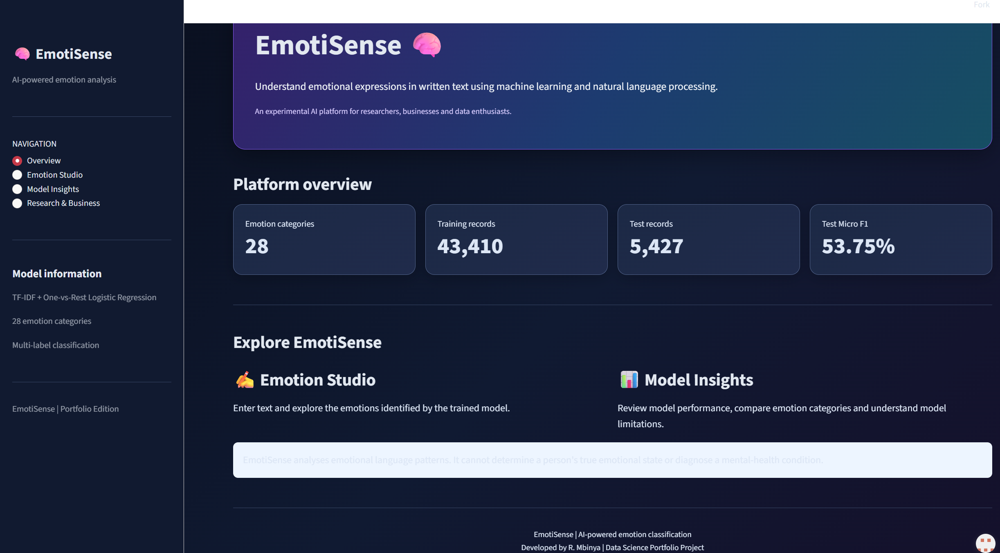
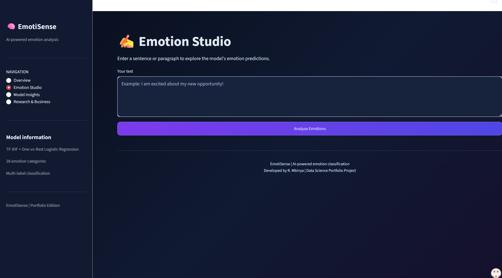
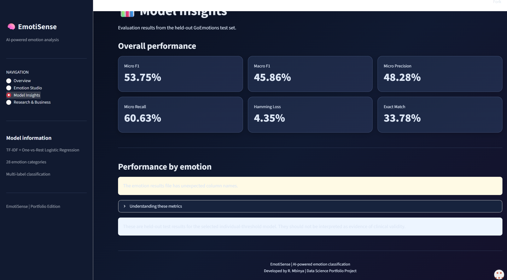
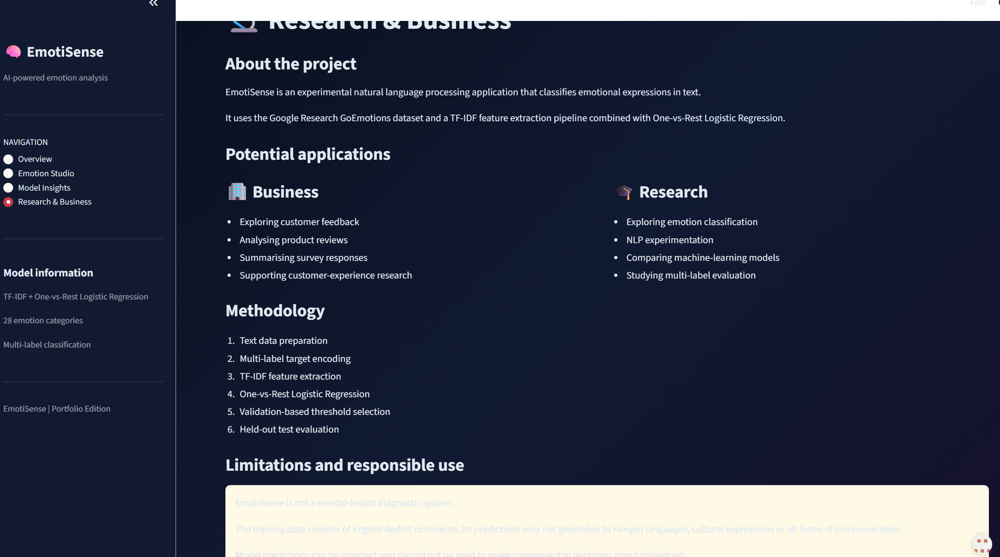

# EmotiSense 🧠

### AI-Powered Emotion Analysis

**Developed by R. Mbinya**

[](https://emotisense-ikjvg3tbej7h5whswryugn.streamlit.app/)
[](https://www.python.org/)
[](https://scikit-learn.org/)

**[Launch the live application](https://emotisense-ikjvg3tbej7h5whswryugn.streamlit.app/)**

EmotiSense is an experimental machine-learning application that analyses written text and predicts possible emotional expressions across 28 categories using a multi-label classification model.

> EmotiSense analyses language patterns. It does not determine a person's actual emotional state or diagnose mental-health conditions.

## Project overview

This project demonstrates an end-to-end natural language processing workflow using the GoEmotions dataset: data auditing, text representation, multi-label model development, threshold tuning, evaluation, packaging, and deployment.

## Application screenshots

### Overview


### Emotion Studio


### Model Insights


### Research & Business


## Key features

- Analyse user-submitted text.
- Predict multiple possible emotion categories.
- Display model scores and threshold-qualified predictions.
- Explore model evaluation and emotion-level performance.
- Review research context, potential applications, and limitations.

## Dataset

The project uses the GoEmotions English Reddit-comment dataset with 28 categories. The official data splits used were:

| Split | Records |
|---|---:|
| Training | 43,410 |
| Development | 5,426 |
| Test | 5,427 |
| **Total** | **54,263** |

## Model and methodology

- **Text features:** TF-IDF, up to 50,000 features, unigrams and bigrams.
- **Classifier:** One-vs-Rest Logistic Regression (`liblinear`).
- **Task:** Multi-label classification across 28 emotion categories.
- **Threshold selection:** Per-emotion thresholds selected using the development split; the test split was reserved for final evaluation.

## Test performance

Selected per-emotion threshold configuration:

| Metric | Test result |
|---|---:|
| Micro F1 | **0.5375** |
| Macro F1 | **0.4586** |
| Precision | 0.4828 |
| Recall | 0.6063 |
| Hamming Loss | 0.0435 |
| Exact Match | 0.3378 |

Threshold tuning improved F1 and recall compared with the default 0.50 threshold, while reducing precision and slightly increasing Hamming Loss. See the case study for the full comparison and interpretation.

## Technology stack

Python · pandas · NumPy · scikit-learn · TF-IDF · Logistic Regression · joblib · Streamlit · Git · GitHub

## Repository structure

```text
EmotiSense_Deploy/
├── model_artifacts/
├── streamlit_app/
│   └── app.py
├── docs/
│   ├── EmotiSense_Case_Study.md
│   └── images/
│       ├── overview.png
│       ├── emotion_studio.png
│       ├── model_insights.png
│       └── research_business.png
├── requirements.txt
└── README.md
```

## Full project case study

Read the [EmotiSense technical case study](docs/EmotiSense_Case_Study.md) for the business problem, dataset audit, methodology, evaluation, limitations, responsible-use considerations, and future improvements.

## Important limitations

- The model was trained on English-language Reddit comments and has not been validated for Kenyan languages, Sheng, or local code-switching.
- Emotion categories are predictions about text, not definitive statements about a person.
- Displayed scores are model scores, not calibrated confidence estimates.
- Class-level performance varies, particularly for less frequent categories.
- The application is experimental and is not a clinical or mental-health diagnostic tool.
- Do not submit identifiable, confidential, or sensitive personal information to the public demonstration.

## Author

**R. Mbinya**  
Data Science Portfolio Project

- **Live application:** https://emotisense-ikjvg3tbej7h5whswryugn.streamlit.app/
- **GitHub repository:** https://github.com/MWANGANGI91/EmotiSense
